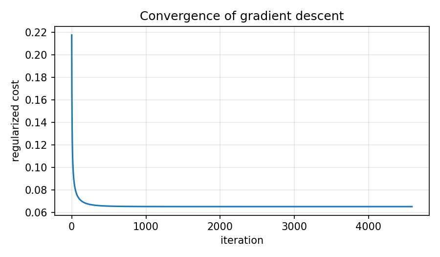
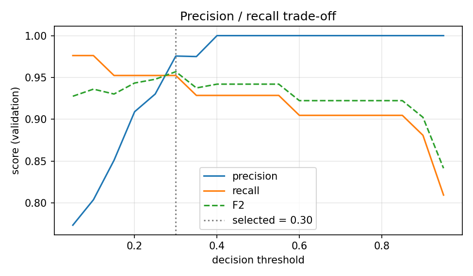
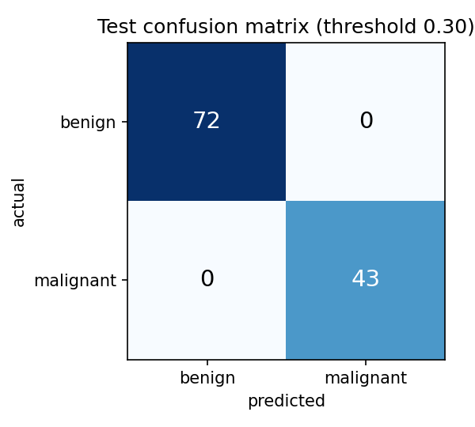
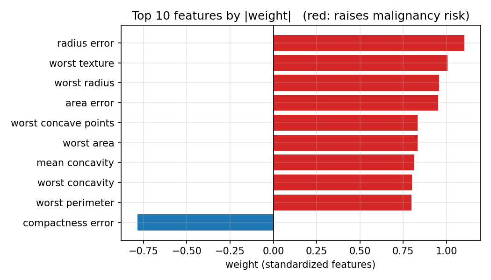

# Logistic Regression from Scratch (NumPy)

[](https://www.python.org/)
[](LICENSE)

L2-regularized **logistic regression implemented from scratch with NumPy**, trained with batch gradient descent, evaluated with a leak-free protocol and **verified against scikit-learn**.

Dataset: Breast Cancer Wisconsin (Diagnostic), 569 samples, 30 features, positive class = malignant.

> **Disclaimer:** educational project on a public teaching dataset. It is **not** a medical tool and must not be used for clinical decisions.

## Results

Reliable estimate: **stratified 5-fold cross-validation** on the development set (threshold 0.5), mean ± std.

| Metric | Value |
|---|---|
| Accuracy | 0.967 ± 0.007 |
| Precision | 0.971 ± 0.030 |
| Recall | 0.941 ± 0.033 |
| F1 | 0.955 ± 0.010 |

Majority-class baseline accuracy: 0.627.

Held-out test set (115 rows, used once): accuracy 0.983, precision 1.000, recall 0.953 at threshold 0.5. With so few rows, one patient moves recall by about 2 points, so prefer the cross-validated numbers above.

**Verification:** same test accuracy as `sklearn.linear_model.LogisticRegression` (0.9826); weights agree to within about 1e-2. A numerical gradient check is part of the test suite.

<p align="center">
  
  
</p>
<p align="center">
  
  
</p>

## What is implemented

- Numerically stable sigmoid and cross-entropy (clipped exponent and probabilities)
- L2 regularization (bias not penalized) and its exact gradient
- Batch gradient descent with a convergence tolerance
- Stratified train / validation / test split (60/20/20) and stratified k-fold CV
- Standardization fitted on training data only (no leakage)
- Decision threshold chosen on the **validation** set by maximizing F2 (recall-weighted), never on the test set
- Precision, recall, F1 and confusion matrix computed by hand

## Quick start

```bash
git clone https://github.com/AhmedShanaa0/logistic-regression-from-scratch.git
cd logistic-regression-from-scratch
pip install -r requirements.txt

python main.py                        # train, evaluate, save figures
python main.py --l2 10 --alpha 0.1    # custom regularization / learning rate
python -m pytest -q                   # run the tests
```

The full walkthrough with explanations and plots is in
[`logistic_regression_from_scratch.ipynb`](logistic_regression_from_scratch.ipynb).

## Project structure

```
.
├── main.py                 # entry point (CLI)
├── src/
│   ├── model.py            # sigmoid, cost, gradient, fit
│   ├── metrics.py          # confusion matrix, precision, recall, F1, F-beta
│   ├── data.py             # loading, stratified split / k-fold, scaling
│   └── plots.py            # figures
├── tests/test_model.py     # gradient check, split check, sklearn comparison
├── figures/                # generated plots
└── logistic_regression_from_scratch.ipynb
```

## Limitations

- Small dataset: every metric has noticeable variance.
- Many features are strongly correlated (radius, perimeter, area), so individual weights should be interpreted with caution.
- No clinical validation of any kind.

## Possible extensions

ROC curve and AUC from scratch, nested cross-validation for `alpha` and `lambda`, class weights for imbalanced data, comparison with other models.

## Data source

Wolberg, W. H., Street, W. N., Mangasarian, O. L. *Breast Cancer Wisconsin (Diagnostic)*. UCI Machine Learning Repository.

## License

MIT, see [LICENSE](LICENSE).

## Author

**Ahmed Shanaa**: [GitHub](https://github.com/AhmedShanaa0) · [LinkedIn](https://www.linkedin.com/in/ahmedshanaa)
